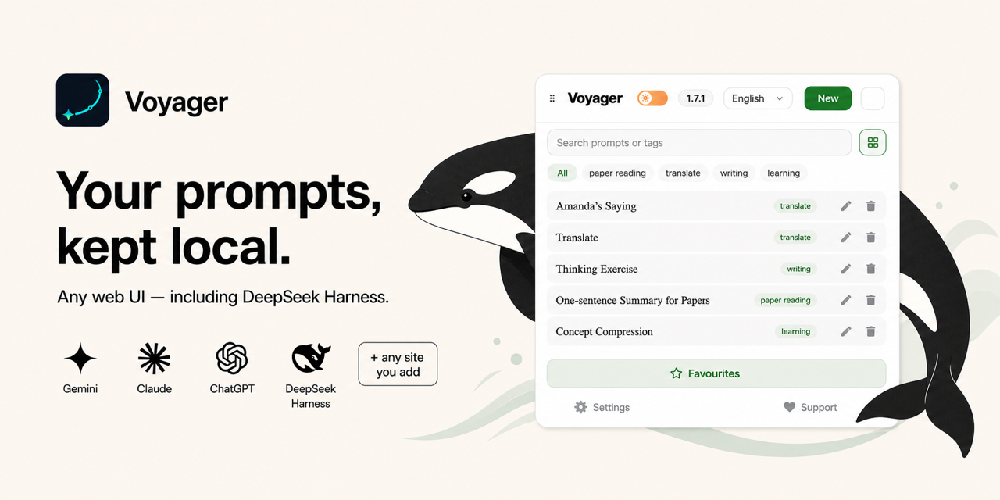

  

Voyager is an open-source enhancement suite for Gemini, AI Studio, Claude, ChatGPT and DeepSeek: timeline navigation, folders, a prompt manager that works on any website, export, cloud sync, and a plugin catalog.

| | |
| --- | --- |
| 🧭 Extension | [voyager-crew/voyager](https://github.com/voyager-crew/voyager) |
| 📖 Docs | [voyager.nagi.fun](https://voyager.nagi.fun/en) |
| 🧩 Plugins | [Plugin catalog](https://voyager.nagi.fun/en/plugins) |
| 🐛 Issues | [Report a bug or request a feature](https://github.com/voyager-crew/voyager/issues/new/choose) |

Install from the [Chrome Web Store](https://chromewebstore.google.com/detail/iifacdnjakkhjjiengaffnegbndgingi), [Edge Add-ons](https://microsoftedge.microsoft.com/addons/detail/voyager/gibmkggjijalcjinbdhcpklodjkhhlne), [Firefox Add-ons](https://addons.mozilla.org/firefox/addon/gemini-voyager/) or the [Safari release](https://github.com/voyager-crew/voyager/releases/latest).
